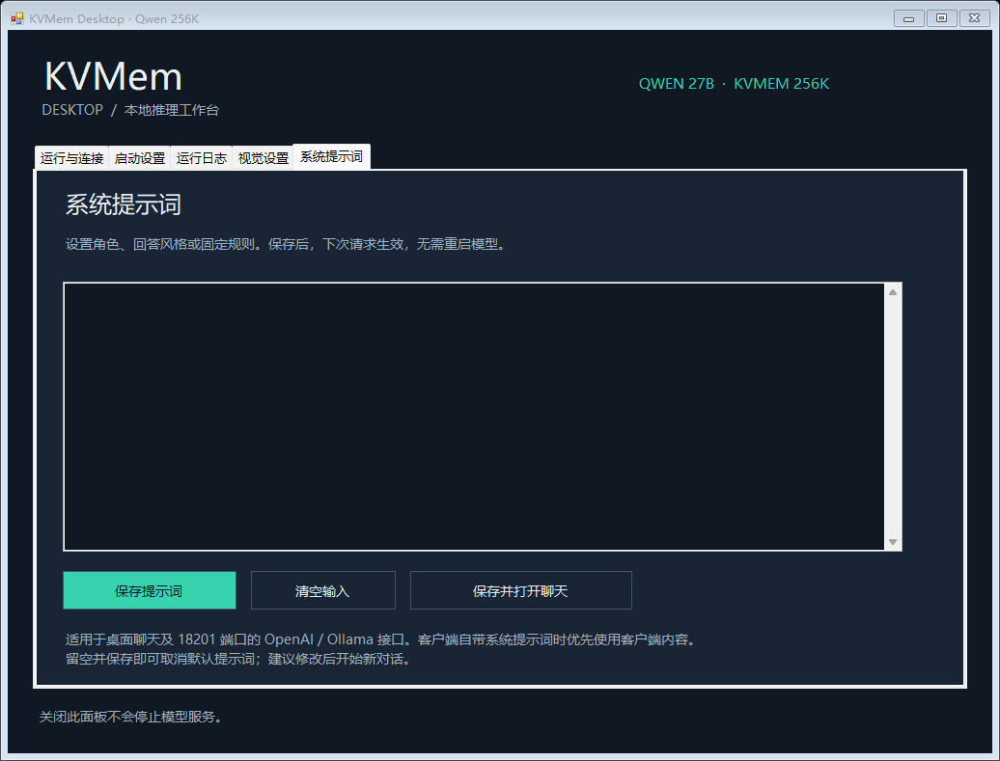

# KVMem Desktop

这是一个用于 [`kvmem-llama.cpp`](https://github.com/kvmem/kvmem-llama.cpp) 的 Windows 桌面启动器和局域网控制面板。

它可以启动/停止 KVMem 模型服务、配置 256K 上下文、打开网页聊天、显示运行日志，并为局域网内的 Mac 提供 OpenAI 兼容地址和文本版 Ollama 兼容地址。

## 使用

1. 下载并完整解压 [v1.2.0 压缩包](dist/KVMem-Desktop-v1.2.0.zip)，可用 [SHA-256 文件](dist/KVMem-Desktop-v1.2.0-SHA256.txt) 校验。
2. 准备好 Windows 版 KVMem 运行包和兼容的 GGUF 模型。
3. 打开 `KVMem.exe`，在“启动设置”中选择 `llama-kvmem-server.exe` 和模型文件。
4. 保存，然后点击“启动服务”。
5. 本机可打开 `http://127.0.0.1:18201/chat`；Mac 使用应用显示的局域网地址。

模型加载或处理请求时也可以点击“停止服务”。停止会中断正在生成的回答以及 Mac 连接，并关闭模型与 Ollama 兼容接口。

模型权重和 KVMem 运行库不包含在本项目中。Ollama 兼容桥只是把文本请求转发给同一份 KVMem 模型，不会重复占用模型显存，也不是 Ollama 原生 KVMem 后端。

DSH Desktop 应使用 `openai-completions` 协议、应用显示的 `http://...:18201/v1` 地址和 GGUF 文件名作为模型 ID。推荐兼容设置：

```yaml
compat:
  supportsDeveloperRole: false
  maxTokensField: max_tokens
```

局域网访问需要点击应用里的“允许局域网访问”并确认 Windows 管理员提示。服务没有身份认证，请仅在可信私有局域网中使用，不要转发到公网。

详细依赖、API、性能数据和构建方法请阅读 [README.md](README.md)。

## 系统提示词

进入“系统提示词”页，输入角色、回答风格或固定规则，点击“保存提示词”。支持中文和多行；“清空输入”后再保存即可取消。提示词单独存入 `system-prompt.json`，覆盖时保留 `.bak`，不会修改模型配置。保存后下一次请求即生效，无需重启模型；修改后建议开始新对话。



默认提示词适用于“打开聊天”及 **18201** 端口的 OpenAI `POST /v1/chat/completions`、Ollama `/api/chat`、`/api/generate`。客户端已有 system/developer 消息时优先保留客户端内容，不重复插入。直接连接 **18200** 端口会绕过默认提示词；已有 OpenAI 客户端请改用 `http://电脑IP:18201/v1`。

“打开聊天”使用随附的文字聊天页，支持流式回答、思考显示、停止生成与新对话；刷新页面会清除对话记录。OpenAI 接口仍可传图片和工具参数，Ollama 接口仍仅支持文本。提示词文件及备份不会提交 Git，也不包含在分发包中。